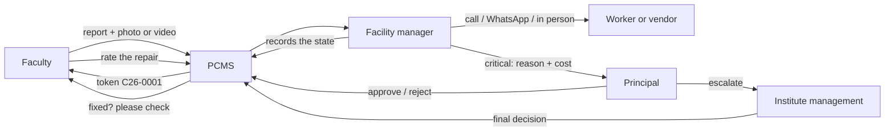

# PCMS: campus maintenance for DBIT Bengaluru

Faculty and staff report a fault from their phone or desktop, with photos or a short video from the in-app
camera, and get a token such as `C26-0001`. The facility manager reviews it, contacts a worker
directly (call, WhatsApp or in person) and records the state, including the exact cost if money was
spent. Critical spending goes to the principal, who approves it or escalates it to institute management.
The reporter confirms the fix and rates the repair. Every step is recorded.

Screens are in English, Kannada and Hindi. The facility manager also sees what people type
translated into his language.

It is an installable web app (PWA) that runs on the college server in Docker. Nothing but the app
itself faces the network: there are no webhooks or public links. Notifications are web push only, to
the phones and computers where people turned them on. The only outbound calls with ticket text are
the translations for the facility manager (MyMemory, with Google as backup); set
`PCMS_TRANSLATION_PROVIDER=none` to keep all text on the server.



| Who | Signs in with | Can do |
|---|---|---|
| Faculty | College email + password | Report with photos and video (in-app camera), track, confirm completion or reopen, rate the service |
| Facility manager | College email + password | Queue with filters, review, contact workers and record the state, close; staff messages, documents; sees typed text translated into Kannada or Hindi |
| Principal | College email + password | First decision on critical spending: approve, reject or escalate to institute management; staff messages, documents, reports, expenditure |
| Institute management | College email + password | Final decision on spending the principal escalates; staff messages, documents, reports, expenditure |
| Super admin (Team OSSC) | College email + password + authenticator app | Everything, including people, Excel or CSV import (with department and position; returns temporary passwords), types, places, removing tickets, audit |

Workers have no login and are contacted directly. PCMS stores an optional worker or vendor
name on the ticket for staff; it sends no messages to workers.

## Documentation

- [docs/DEPLOYMENT.md](docs/DEPLOYMENT.md): install on the college server, HTTPS, web push, backups, continuous deployment
- [docs/pcms-deployment-2026-11-02.md](docs/pcms-deployment-2026-11-02.md): how staging runs on the OSSC server, and setting up CD there
- [docs/ARCHITECTURE.md](docs/ARCHITECTURE.md): components, data, the confirmed ticket flow (diagrams)
- [docs/SECURITY.md](docs/SECURITY.md): controls, and where DBIT's decisions differ from plan v1.2
- [docs/USER-GUIDE.md](docs/USER-GUIDE.md): short guide for each role
- [AGENTS.md](AGENTS.md): rules and layout for maintainers and AI coding agents
- [CONTRIBUTING.md](CONTRIBUTING.md): how to make, test, document and submit a change
- [CHANGELOG.md](CHANGELOG.md): what changed in each release, and what operators must do
- [CODE_OF_CONDUCT.md](CODE_OF_CONDUCT.md)
- [backend/openapi/openapi.json](backend/openapi/openapi.json): the API contract (`python -m app.cli export-openapi`)

## License and maintainers

Proprietary. Copyright (c) 2026 Don Bosco Institute of Technology, Bengaluru, and the Open Source
Student Club, DBIT. All rights reserved; see [LICENSE](LICENSE). PCMS is maintained and regulated by
the Open Source Student Club, DBIT.

## Deploying

The server runs only `compose.prod.yml`. Pushing to `dev` deploys staging and pushing to `main`
deploys production, after CI passes (see [docs/DEPLOYMENT.md](docs/DEPLOYMENT.md) section 8).
`compose.dev.yml` below is for your own computer and for CI's tests, never for the server.

## Run it on your computer (development)

Needs Docker Desktop. From the repository folder (PowerShell or bash):

```sh
docker compose -f compose.dev.yml --profile jobs --profile nginx up -d --build
docker compose -f compose.dev.yml exec api python -m app.cli create-test-accounts
```

- App with live reload: http://localhost:5173. Built app through nginx: http://localhost:8080
- The second command prints one email and temporary password per role. Each account must set a new password at first sign-in.
- Ports, the database login, translation and the Team OSSC admins are set in `.env` (gitignored).
  Every setting has a labelled line there; `.env.example` is the production template.
  To create the admins listed there: `docker compose -f compose.dev.yml exec api python -m app.cli create-admin-from-env`.

Notifications are web push only. To get them locally, generate keys with `python -m app.cli vapid-keys`
and put them in `.env` next to `compose.dev.yml` (it is gitignored). Then recreate `api` and `worker`.

## Tests

```sh
docker compose -f compose.dev.yml exec api pytest -q          # backend, against real PostgreSQL
cd frontend && npm run lint && npm run build                  # frontend
```

The browser test (phone and desktop viewports) is in `e2e/` and runs in CI (`.github/workflows/ci.yml`).
See the workflow file for the exact commands. Run on your computer, it creates `smoke-*` accounts and
test tickets in your dev database. To start clean afterwards: `docker compose -f compose.dev.yml down -v`
(this deletes the dev database and uploads), then `up -d` and `create-admin-from-env` again.
