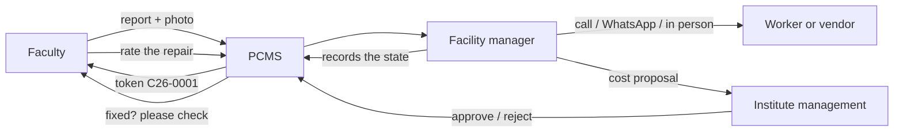

# PCMS: campus maintenance for DBIT Bengaluru

Faculty report a fault from their phone or desktop and get a token such as `C26-0001`.
The facility manager reviews it, contacts a worker directly (call, WhatsApp or in person)
and records the state. Management approves any spending. The faculty member confirms the
fix and rates the repair. Every step is recorded.

It is an installable web app (PWA) that runs on the college server in Docker. Only two
narrow routes face the internet: Twilio's webhooks and short-lived photo links.



| Who | Signs in with | Can do |
|---|---|---|
| Faculty | College email + password | Report, track, message, confirm or dispute the fix, rate the repair |
| Facility manager | College email + password | Queue, review, contact workers and record the state, close |
| Institute management | College email + password | Approve or reject spending, reports |
| Super admin (Team OSSC) | College email + password + authenticator app | Everything, including people, Excel or CSV import, types, places, audit |

Workers have no login and are contacted directly. PCMS stores an optional worker or vendor
name on the ticket for staff; it sends no messages to workers.

## Documentation

- [docs/DEPLOYMENT.md](docs/DEPLOYMENT.md): install on the college server, HTTPS, Twilio, push, backups, updates
- [docs/ARCHITECTURE.md](docs/ARCHITECTURE.md): components, data, the confirmed ticket flow (diagrams)
- [docs/SECURITY.md](docs/SECURITY.md): controls, and where DBIT's decisions differ from plan v1.2
- [docs/USER-GUIDE.md](docs/USER-GUIDE.md): short guide for each role
- [AGENTS.md](AGENTS.md): rules and layout for maintainers and AI coding agents
- [CODE_OF_CONDUCT.md](CODE_OF_CONDUCT.md)
- [backend/openapi/openapi.json](backend/openapi/openapi.json): the API contract (`python -m app.cli export-openapi`)

## License and maintainers

Proprietary. Copyright (c) 2026 Don Bosco Institute of Technology, Bengaluru, and the Open Source
Student Club, DBIT. All rights reserved; see [LICENSE](LICENSE). PCMS is maintained and regulated by
the Open Source Student Club, DBIT.

## Run it on your computer (development)

Needs Docker Desktop. From the repository folder (PowerShell or bash):

```sh
docker compose -f compose.dev.yml --profile jobs --profile nginx up -d --build
docker compose -f compose.dev.yml exec api python -m app.cli create-test-accounts
```

- App with live reload: http://localhost:5173. Built app through nginx: http://localhost:8080
- Emails sent by the app: http://localhost:8025 (Mailpit)
- The second command prints one email and temporary password per role. Each account must set a new password at first sign-in.

To test push notifications locally, generate keys with `python -m app.cli vapid-keys` and put them in
a `.env` file next to `compose.dev.yml` (it is gitignored). Then recreate `api` and `worker`.

## Tests

```sh
docker compose -f compose.dev.yml exec api pytest -q          # backend, against real PostgreSQL
cd frontend && npm run lint && npm run build                  # frontend
```

The browser test (phone and desktop viewports) is in `e2e/` and runs in CI (`.github/workflows/ci.yml`).
See the workflow file for the exact commands.
