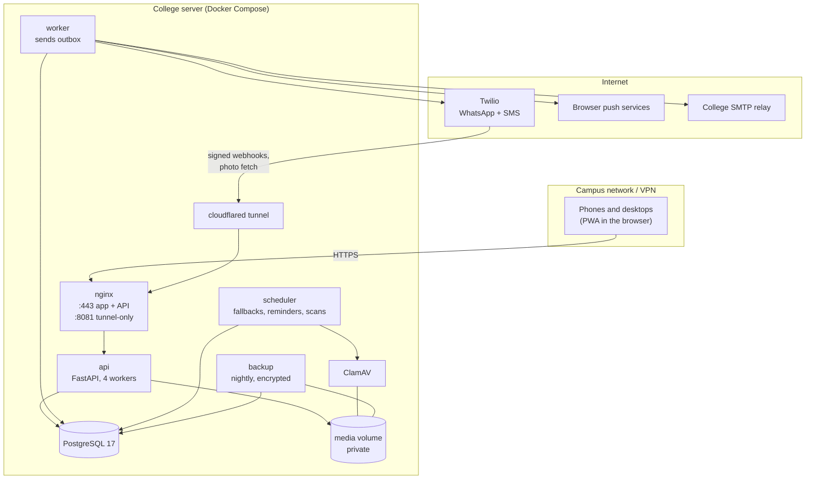
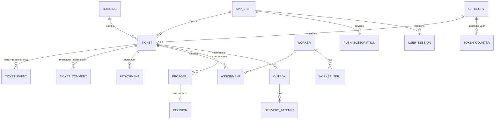
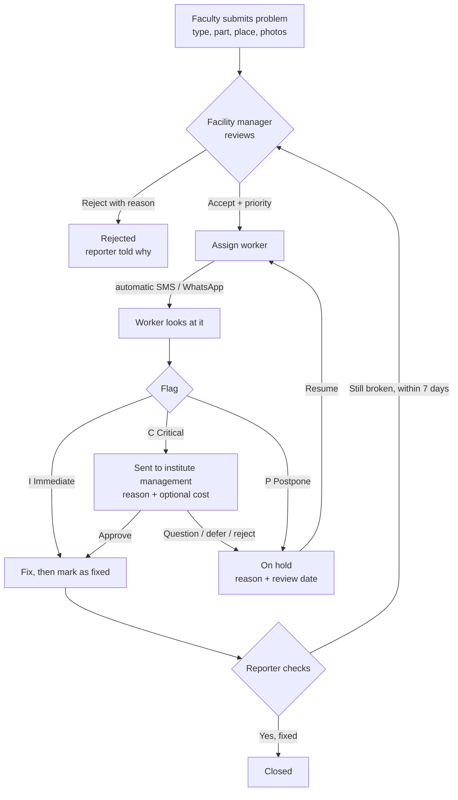
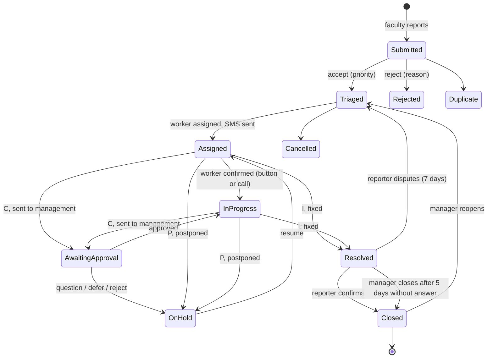
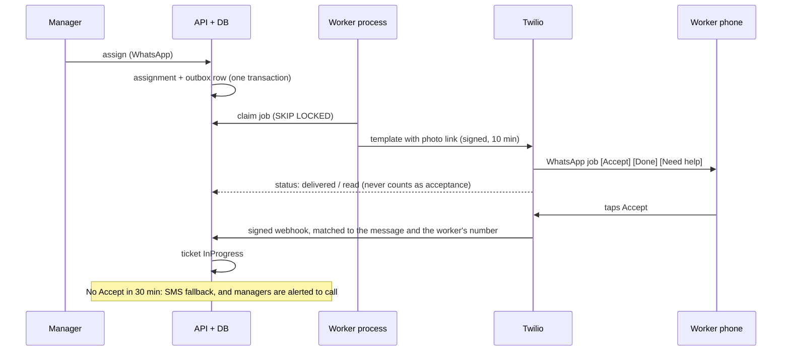

# Architecture

## Components

- The API, database, ClamAV and jobs sit on an internal Docker network with no internet route.
  Only `worker`, `clamav` (signature updates) and `tunnel` have egress.
- The tunnel reaches nginx's port 8081 only. That listener serves exactly
  `POST /webhooks/twilio`, `POST /webhooks/twilio/status` and `GET /media/public/<signed token>`.
  Everything else there is 404.
- Provider calls never happen inside a database transaction. A ticket change and its
  notification intent (outbox row) commit together; the worker sends afterwards.

## Data model (main tables)

Rules the database enforces: valid statuses and roles, one active lead per ticket, one pending
proposal per ticket, one decision per proposal version, non-negative money in integer paise,
unique tokens and phone numbers. Timeline, comments, decisions, delivery attempts and the
audit log cannot be updated or deleted (trigger).

## Tokens

`<type letter><2-digit year>-<serial>`, for example `C26-0001` is the first Carpentry ticket of 2026.
The serial comes from a counter row locked inside the create transaction, per type and per
Asia/Kolkata year, so 100 parallel submissions still get 100 unique, consecutive tokens. A ticket
keeps its token if its type changes later. Letters are never reused.

| Letter | Type | Letter | Type |
|---|---|---|---|
| C | Carpentry | F | Flooring |
| P | Plumbing | W | Toilets (washrooms) |
| I | Internet | E | Electrical |
| T | Phone | O | Other |
| R | Projector | | |

## Ticket lifecycle

This is the flow DBIT confirmed on 18 October 2026.

Status names used by the API:

**Future scope.** The worker giving the reason for Critical or Postpone directly (SMS reply,
voice or a very simple form). For now the facility manager records it, because many workers do
not use apps.

Every action carries the ticket version the person saw; a stale version gets `409` and the screen reloads.

## Sign-in

## Dispatch and fallback

Retries happen at 1, 5, 15 and 60 minutes, then the message goes to "messages need you" in the queue.
Notifications for reassigned or finished jobs expire instead of being sent.

## Notifications to people

- Web push (VAPID) to every device a person enabled. The subscription is saved again on every app
  open, and dead subscriptions are removed when the push service reports them gone. Payloads hold
  only a title, a short line and an in-app link.
- Email through the college relay, for people with an email address.
