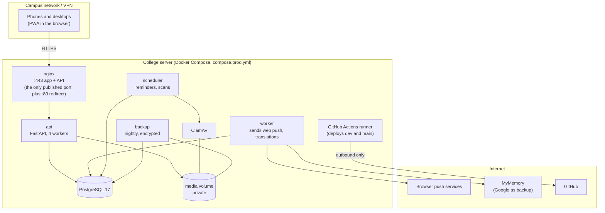
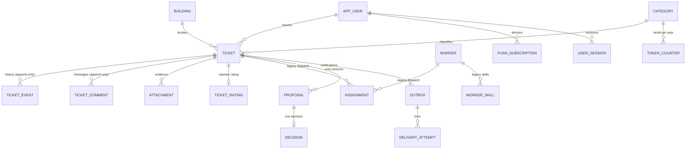
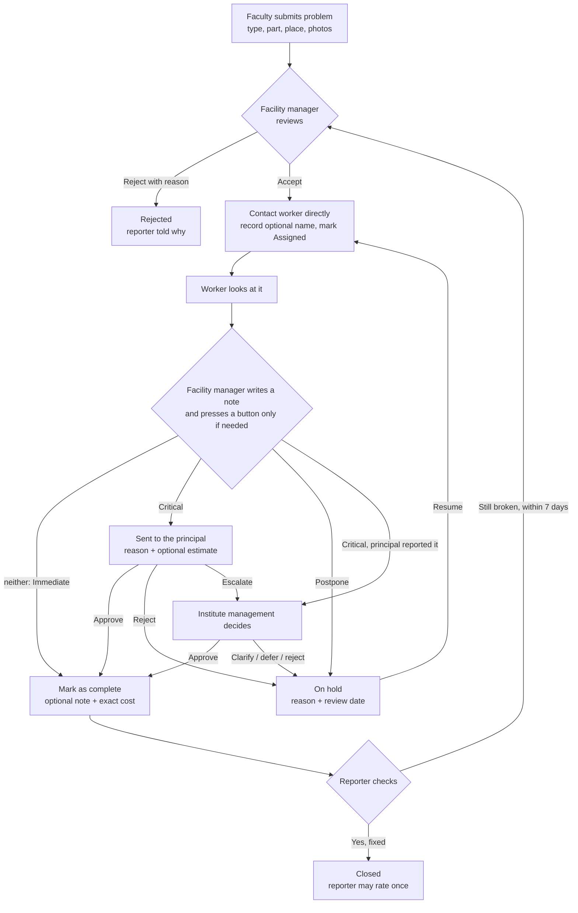
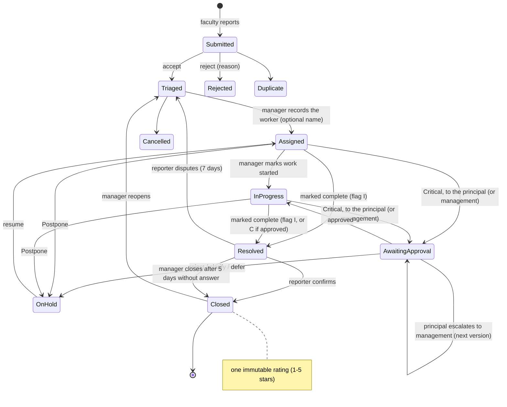
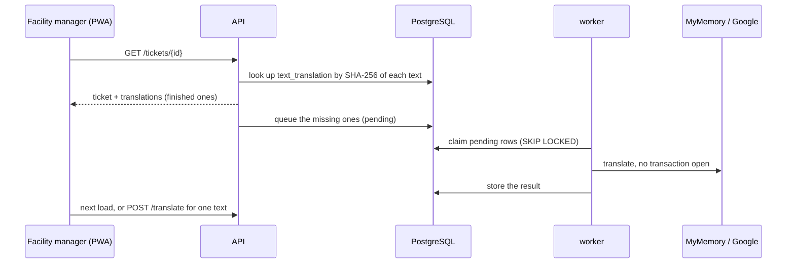
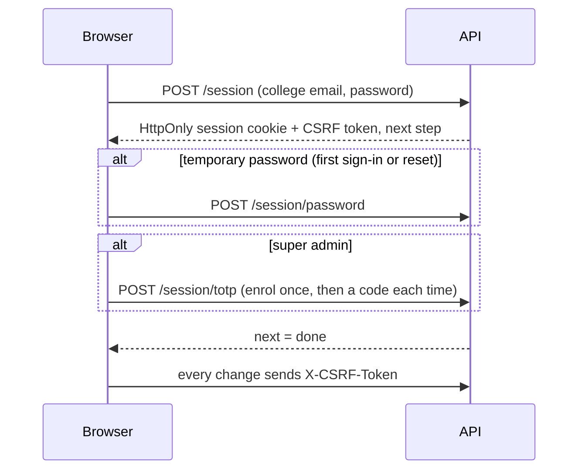
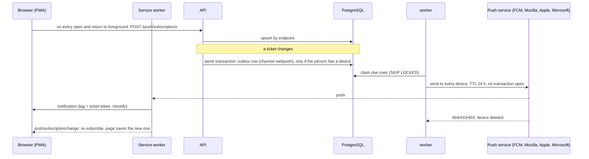

# Architecture

## Components

- The API, database, ClamAV and jobs sit on an internal Docker network with no internet route.
  Only `worker` (push services, translators) and `clamav` (signature updates) have egress. nginx also
  joins a normal network, because Docker cannot publish ports from a container that is only on an
  internal one.
- Nothing on the server accepts connections from the internet except the app through its own HTTPS
  port (through the Cloudflare tunnel on staging). There are no webhooks and no public media links.
- The runner connects out to GitHub and runs `ops/deploy/deploy.sh` (DEPLOYMENT.md section 8).
- Push and translation calls never happen inside a database transaction. A ticket change and its
  notification intent (outbox row) commit together; the worker sends afterwards.

## Data model (main tables)

Rules the database enforces: valid statuses and roles, one active lead per ticket, one pending
proposal per ticket, one decision per proposal version, one rating per ticket, non-negative money
in integer paise, unique tokens and phone numbers. Timeline, comments, decisions, delivery
attempts and the audit log cannot be updated or deleted (trigger). The `worker`, `worker_skill`
and `assignment` tables remain for history; the normal flow writes no new rows to them.

## Tokens

`<type letter><2-digit year>-<serial>`, for example `C26-0001` is the first Carpentry ticket of 2026.
The serial comes from a counter row locked inside the create transaction, per type and per
Asia/Kolkata year, so 100 parallel submissions still get 100 unique, consecutive tokens. A ticket
keeps its token if its type changes later. Letters are never reused.

| Letter | Type | Letter | Type |
|---|---|---|---|
| C | Carpentry | F | Flooring |
| P | Plumbing | W | Toilets (washrooms) |
| I | Internet | E | Electrical |
| T | Phone | O | Other |
| R | Projector | | |

## Ticket lifecycle

This is the flow DBIT confirmed on 18 October 2026, as changed on 4 November 2026. Every role
reports problems the same way: a report by the principal, management or a facility manager waits
for the facility manager's review like any other.

Status names used by the API:

**Future scope.** Letting workers record progress themselves, for example by SMS reply or a very
simple form. For now the facility manager records it, because many workers do not use apps.

Every action carries the ticket version the person saw; a stale version gets `409` and the screen reloads.

**The work flag.** `ticket.flag` (I, C or P) is no longer chosen up front (DBIT, 4 November 2026). The
server sets it: `hold` sets P, a proposal sets C, `resume` clears P, and `resolve` sets I unless the
ticket is C. The closing note and the actual cost (`actualCostPaise`, integer paise, optional) are both
optional on `resolve`. The old `set_flag` action and the `flag` list filter still work for API clients.

**Removed tickets.** `POST /tickets/{id}/remove` (`admin.tickets`, Team OSSC only, reason required)
closes an open ticket as Cancelled, sets `deleted_at`, `deleted_by` and `delete_reason`, and writes an
internal timeline entry and an audit event. No row is deleted. Every ticket query excludes
`deleted_at IS NOT NULL`: `get_visible` (404), the lists, duplicates, the scheduler, and all reports and
exports through `reporting.ticket_filters` and `reporting.raw_scope`.

**Severity, not priority.** The reporter picks red (urgent or unsafe), orange (soon) or green
(routine). Staff never set a priority. The `ticket.priority` column remains only as the internal
update-reminder clock, derived from the severity (red P1, orange P2, green P4), and is not in the API.

**Spending stages.** Each proposal version has a `stage`: `principal` or `management`. A new
request starts at `principal`, except when the principal reported the problem: then it starts at
`management` (4 November 2026), because nobody decides spending on their own report. The principal (`cost.principal`) approves, rejects or escalates.
Escalating records an `escalated` decision on the current version and creates the next version
at the `management` stage, so every version still has exactly one decision. Institute management
(`cost.approve`) then approves, asks for clarification, defers or rejects. Each stage can only be
decided by its own role, and separation of duty applies at both.

**Staff messages.** Messages on a ticket are a staff discussion: the facility manager, institute
management, the principal and Team OSSC read and write them. Faculty neither see nor send them;
the reporter follows progress through the public timeline and notifications.

**Attachments.** The reporter adds photos and video to their own ticket (in-app camera or file); staff view
them but do not add to them. Every staff role (`ticket.attach`) adds documents (`purpose=document`): PDF,
Office, text or images. Each attachment records who added it.
Faculty see their own name, or "Facilities team" for staff uploads. Documents are internal: the
API never returns them to the reporter, the timeline entry is internal, and downloads are always
`Content-Disposition: attachment`.

**Reports and expenditure.** Every report and download takes a From and a To date (whole days in
Asia/Kolkata, both included). `GET /reports/expenditure` (and `.csv`, `.xlsx`) lists the requests
raised in the period with requested, approved and awaiting amounts in INR; an escalated request is
counted once, with its final decision. Only `cost.principal` and `cost.approve` see spending; for
the facility manager `approvedPaise` is `null`. The ticket list can also be filtered by reporter
name or email, reporter role and a From/To date.

The expenditure report also gives `actualPaise` and `actualCount`: the exact costs recorded on repairs
marked complete in the period, with or without a request, and each request's actual cost next to its
approved limit (also in the CSV, Excel and PDF). Its `byDepartment` gives, per building and department,
`requests`, `requestedPaise`, `approvedPaise` and `pendingPaise` for requests raised in the period, and
`repairs` and `actualPaise` for repairs fixed in the period, sorted by actual cost. Its rows add up to the
period totals. `GET /reports` returns `byDepartment` (per building and
department: reported, open, fixed, overdue, and `actualPaise` for spending roles, `null` otherwise; the
PWA shows spending only from the expenditure report, so there is one set of figures) and
`byType`. A department filter alone (no building) is accepted when some building has that department.

An **assessment** can be recorded while work is assigned or in progress. It says what the job
needs (one person, more people, parts, money up front) and how it was reported, and lands in
the timeline as an internal entry, so it never reaches the reporter.

## Ratings

After the reporter confirms the fix, the ticket is `Closed` and the reporter may submit one
rating: 1-5 stars and an optional comment of up to 1000 characters. There is no edit or delete
endpoint. The unique ticket id is the concurrency guard, so a second rating returns `409
already_rated`. Staff see the rating on the ticket; the public timeline records only the star
count. A 1 or 2 star rating queues a facility-manager notification through the outbox. Reports
show the count, average, 5-to-1 distribution and the ten newest low ratings.

## Listing, search and paging

`GET /tickets` is the one list endpoint. It takes `scope` (`mine` or `queue`), `status`, `open`,
`search`, `category`, `flag`, `severity`, `building`, `worker`, `sort`, `page` and `pageSize`,
and returns `{items, total, page, pageSize}`. The `worker` filter matches the optional free-text
worker or vendor name and is available only on the staff queue.

Every filter is applied in SQL, never in the browser. The client used to fetch a fixed 100 rows
and filter them locally, which silently hid older tickets; it now sends the filters and renders
the server's `total`. `sort` is one of `newest`, `oldest`, `severity` (red, orange, green) or `updated`, and each
order has an `id` tiebreaker so paging stays stable when timestamps collide.

The queue also takes `department`, `overdue=true` (the promised next update is late) and `view`
(`action` or `working`, the queue tabs). The tabs used to filter the current page in the browser, so the
counts and pages did not match the list; they are now SQL like every other filter. The PWA keeps the
filters in the page address.

Search matches title, token and room with `ILIKE`. Wildcards `%` and `_` in the query are
escaped, so a search for `100%` looks for that text instead of matching everything.
Out-of-range values for `severity`, `flag` and `sort` are rejected rather than ignored.

`GET /catalogs` returns active types and places only, so a retired one cannot be picked on a new
report. `GET /catalogs?includeInactive=true` is for the administration screens, which need to
show a retired row so it can be restored. Old tickets render either way, because the frontend
falls back to a placeholder for an unknown code.

## Translation (facility manager)

DBIT's facility manager is not fluent in English (1 November 2026). Text people type (titles, descriptions,
staff messages, hold reasons, timeline entries, rating comments) is machine-translated between English,
Kannada and Hindi for that role only.

- The script decides the source language: Kannada letters, Devanagari (Hindi), otherwise English.
- The API has no internet route, so only the worker calls the translators. MyMemory is tried first;
  when it fails or its daily limit is used up, the worker tries Google through `googletrans-curl`.
  Failures retry after 1, 10, 60 and 360 minutes, then stop.
- Each text is translated once per language and cached in `text_translation`. The original is never
  replaced and the screen offers **Show original**.
- Translations are added only to the facility manager's responses, and only for text already in that
  response, so they follow the normal visibility rules. `POST /translate` (the language buttons under
  a text box) is facility manager only and throttled.
- Settings: `PCMS_TRANSLATION_PROVIDER` (`mymemory` or `none`), `PCMS_TRANSLATION_EMAIL`,
  `PCMS_TRANSLATION_FALLBACK` (`google` or `none`).

## Evidence and documents

| Who | Photos and video | Documents |
|---|---|---|
| Reporter (any role) | Adds to their own ticket: in-app camera or file | Never sees them |
| Facility manager | Views and plays | Adds; sees their own and those by the principal or management |
| Principal, management, Team OSSC | Views and plays | Adds; sees all, including the facility manager's |

The upload carries `purpose=evidence` or `purpose=document`, and the server checks it against the role.
The in-app camera records with `MediaRecorder` (WebM or MP4, 720p, no sound, 30 seconds). Browser
recordings have no duration until they are remuxed, so the server remuxes first and checks the clean copy.

## The installed app

The web app manifest's `start_url` is `/login`, so the installed app opens sign-in (or the person's home
screen when already signed in). The landing page at `/` is for the browser.

## Sign-in

## Worker contact

Facility managers contact workers directly and then record the state on the ticket. The name of
the worker, vendor or team is optional free text, is stored on the ticket, and is shown only to
staff. PCMS has no worker directory, worker login, phone number field or automatic job message.
The manager marks the ticket `Assigned`, may mark work started, and then marks it complete or presses
Critical or Postpone.

Twilio messaging and its webhooks were removed on 4 November 2026. The `worker`, `worker_skill`,
`assignment` and `provider_event` tables stay for history; nothing writes them.

## Notifications to people (web push only)

Web push is the only channel (DBIT, 4 November 2026: email and Twilio removed).

- **Collecting the subscription.** After sign-in the app saves this device's subscription on every open,
  again when it returns to the foreground (at most hourly), and immediately when the service worker
  reports `pushsubscriptionchange`. A subscription made with old VAPID keys is replaced. So the server
  always has a working entry for every device without anyone doing anything (`frontend/src/lib/push.ts`,
  `startPushSync`).
- **Who gets what.** `notify_reporter` (status changes, receipt, verification reminder), `notify_role`
  (new report and dispute to facility managers, approval needed to the principal or management, low
  rating, hold review) and `notify_user` (decisions to the requester). Nothing is queued for a person
  with no device on; the ticket in the app always shows the current state.
- **Payload.** Only a title (up to 100 characters), a short line (up to 240), an in-app link and the ticket
  token as the tag. Text is shortened at a word with `...` (`notify.clip`). Never notes, costs or names
  of staff, because payloads pass through the browser vendors' push services.
- **Delivery.** The `worker` sends to every device of the person. A device the push service reports gone
  (404, 410, 403) is deleted; when all are gone the row expires. Other failures retry at 1, 5, 15 and 60
  minutes, then stop as `action_required` (counted as "Undelivered notifications" in Reports).
- **Turning it off** in Settings is remembered on that device; the app does not re-subscribe until it is
  turned on again. "Not now" on the permission banner keeps it away for 7 days.
- **Production requires push.** `check_production()` refuses to start without the VAPID keys or with the
  `@localhost` VAPID subject.
