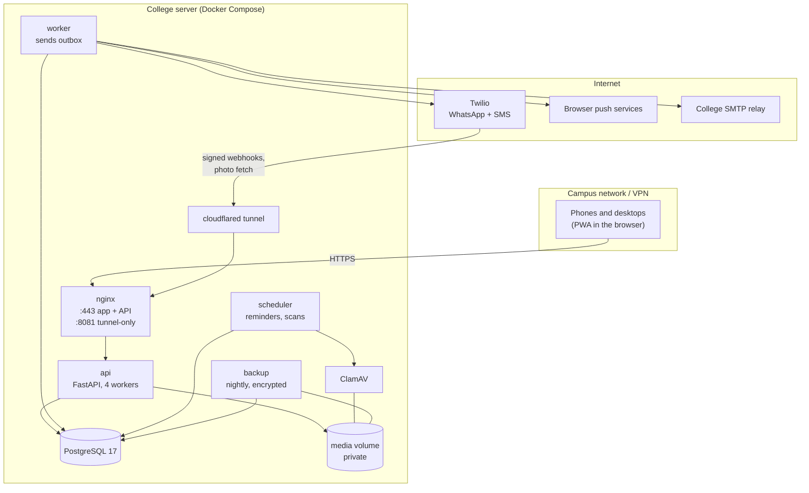
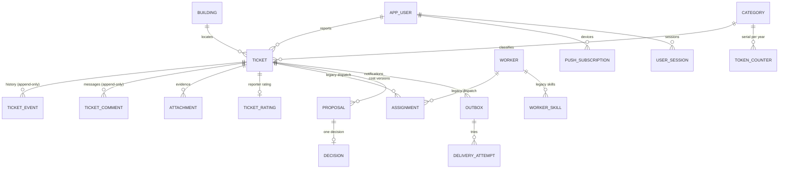
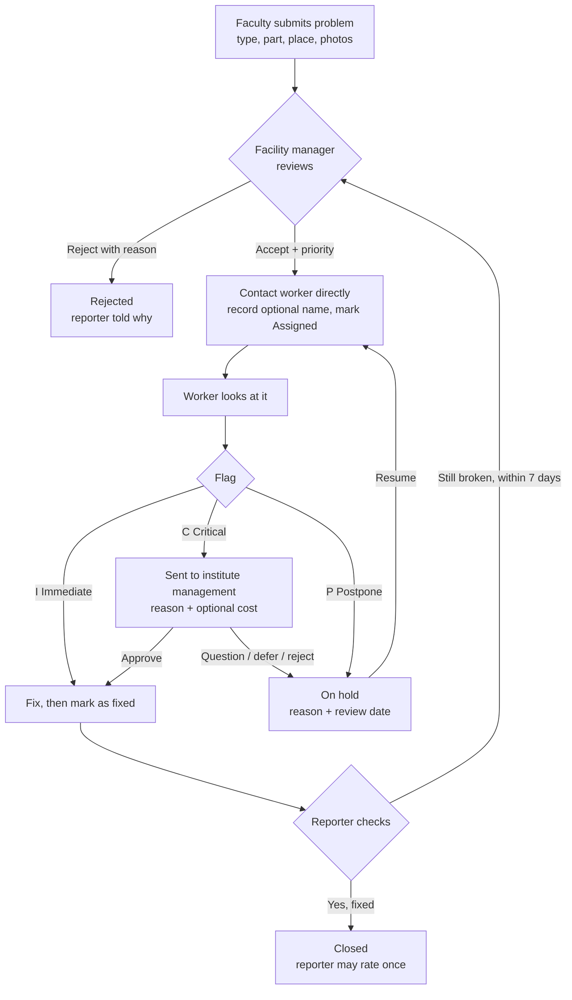
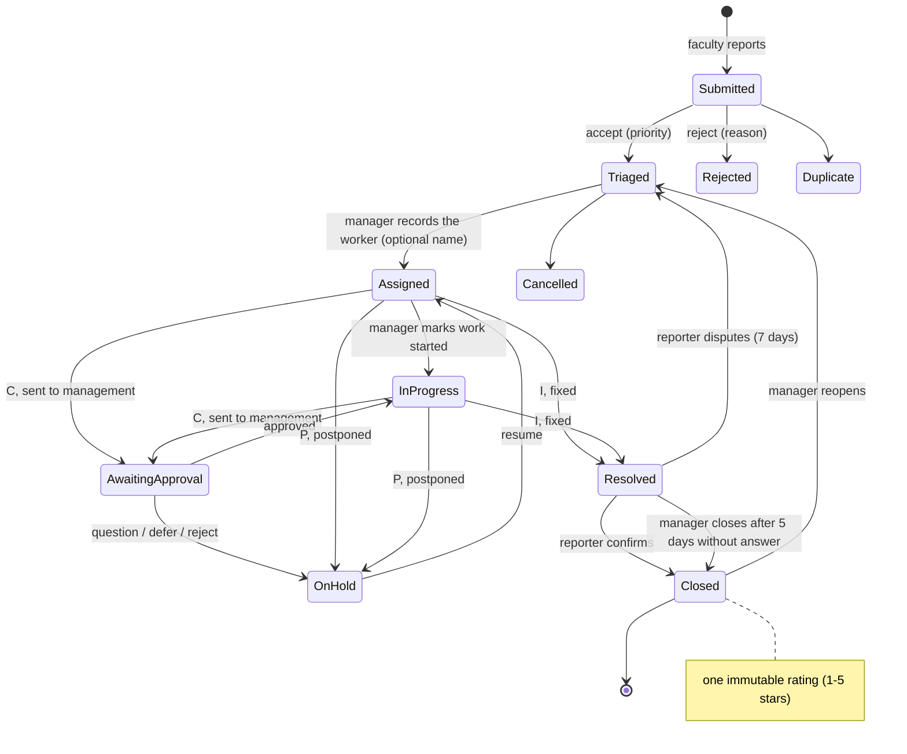
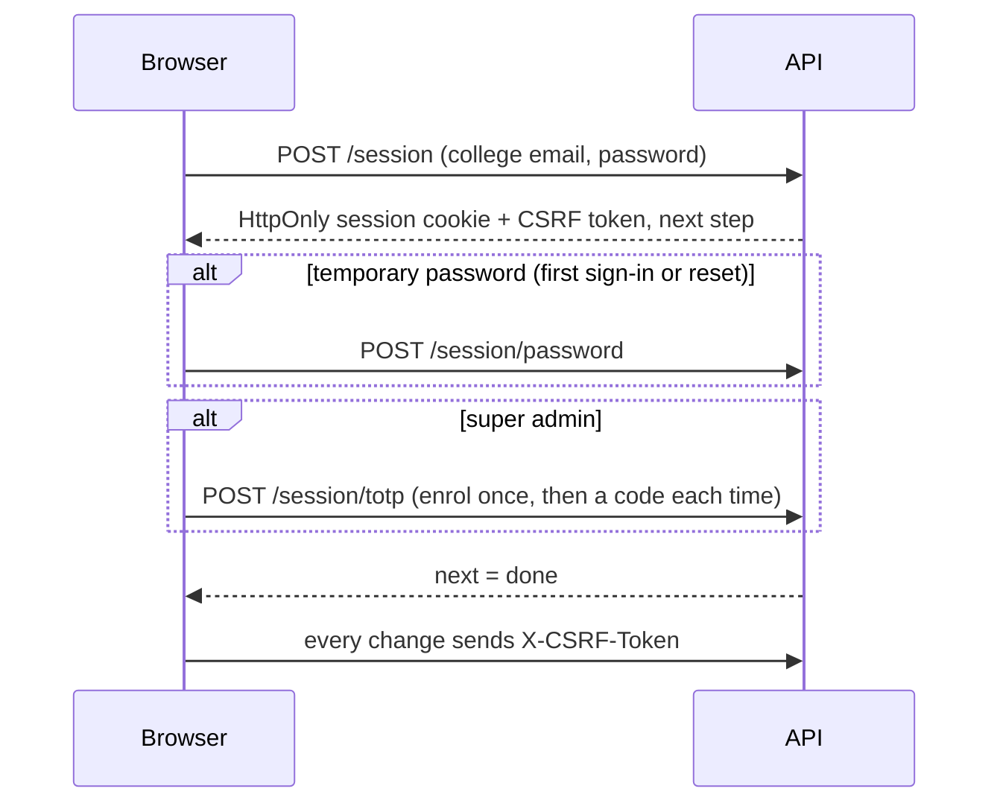

# Architecture

## Components

- The API, database, ClamAV and jobs sit on an internal Docker network with no internet route.
  Only `worker`, `clamav` (signature updates) and `tunnel` have egress.
- The tunnel reaches nginx's port 8081 only. That listener serves exactly
  `POST /webhooks/twilio`, `POST /webhooks/twilio/status` and `GET /media/public/<signed token>`.
  Everything else there is 404.
- Provider calls never happen inside a database transaction. A ticket change and its
  notification intent (outbox row) commit together; the worker sends afterwards.

## Data model (main tables)

Rules the database enforces: valid statuses and roles, one active lead per ticket, one pending
proposal per ticket, one decision per proposal version, one rating per ticket, non-negative money
in integer paise, unique tokens and phone numbers. Timeline, comments, decisions, delivery
attempts and the audit log cannot be updated or deleted (trigger). The `worker`, `worker_skill`
and `assignment` tables remain for history; the normal flow writes no new rows to them.

## Tokens

`<type letter><2-digit year>-<serial>`, for example `C26-0001` is the first Carpentry ticket of 2026.
The serial comes from a counter row locked inside the create transaction, per type and per
Asia/Kolkata year, so 100 parallel submissions still get 100 unique, consecutive tokens. A ticket
keeps its token if its type changes later. Letters are never reused.

| Letter | Type | Letter | Type |
|---|---|---|---|
| C | Carpentry | F | Flooring |
| P | Plumbing | W | Toilets (washrooms) |
| I | Internet | E | Electrical |
| T | Phone | O | Other |
| R | Projector | | |

## Ticket lifecycle

This is the flow DBIT confirmed on 18 October 2026.

Status names used by the API:

**Future scope.** Letting workers record progress themselves, for example by SMS reply or a very
simple form. For now the facility manager records it, because many workers do not use apps.

Every action carries the ticket version the person saw; a stale version gets `409` and the screen reloads.

An **assessment** can be recorded while work is assigned or in progress. It says what the job
needs (one person, more people, parts, money up front) and how it was reported, and lands in
the timeline as an internal entry, so it never reaches the reporter.

## Ratings

After the reporter confirms the fix, the ticket is `Closed` and the reporter may submit one
rating: 1-5 stars and an optional comment of up to 1000 characters. There is no edit or delete
endpoint. The unique ticket id is the concurrency guard, so a second rating returns `409
already_rated`. Staff see the rating on the ticket; the public timeline records only the star
count. A 1 or 2 star rating queues a facility-manager notification through the outbox. Reports
show the count, average, 5-to-1 distribution and the ten newest low ratings.

## Listing, search and paging

`GET /tickets` is the one list endpoint. It takes `scope` (`mine` or `queue`), `status`, `open`,
`search`, `category`, `flag`, `priority`, `building`, `worker`, `sort`, `page` and `pageSize`,
and returns `{items, total, page, pageSize}`. The `worker` filter matches the optional free-text
worker or vendor name and is available only on the staff queue.

Every filter is applied in SQL, never in the browser. The client used to fetch a fixed 100 rows
and filter them locally, which silently hid older tickets; it now sends the filters and renders
the server's `total`. `sort` is one of `newest`, `oldest`, `priority` or `updated`, and each
order has an `id` tiebreaker so paging stays stable when timestamps collide.

Search matches title, token and room with `ILIKE`. Wildcards `%` and `_` in the query are
escaped, so a search for `100%` looks for that text instead of matching everything.
Out-of-range values for `priority`, `flag` and `sort` are rejected rather than ignored.

`GET /catalogs` returns active types and places only, so a retired one cannot be picked on a new
report. `GET /catalogs?includeInactive=true` is for the administration screens, which need to
show a retired row so it can be restored. Old tickets render either way, because the frontend
falls back to a placeholder for an unknown code.

## Sign-in

## Worker contact and legacy dispatch

Facility managers contact workers directly and then record the state on the ticket. The name of
the worker, vendor or team is optional free text, is stored on the ticket, and is shown only to
staff. PCMS has no worker directory, worker login, phone number field or automatic job message.
The manager marks the ticket `Assigned`, may mark work started, and records the I/C/P flag.

Twilio webhooks and the worker-delivery branches in the outbox remain for messages that were
already sent before this change. Their status updates and Accept taps still work, and their
templates still exist. No new worker message is queued. A later cleanup release can remove the
provider settings and the legacy tables once those messages are drained.

Retries happen at 1, 5, 15 and 60 minutes, then the message goes to "messages need you" in the queue.
Notifications for reassigned or finished jobs expire instead of being sent.

## Notifications to people

- Web push (VAPID) to every device a person enabled. The subscription is saved again on every app
  open, and dead subscriptions are removed when the push service reports them gone. Payloads hold
  only a title, a short line and an in-app link.
- Email through the college relay, for people with an email address.
