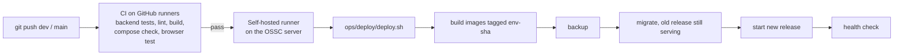

# Deploying PCMS on the college server

Ownership follows plan v1.2 section 25:
- **College IT** owns the server, DNS, certificates and firewall.
- **Facilities** owns the service.
- **Team OSSC** prepares releases.

The commands below are for a Linux server (Ubuntu 24.04 LTS or similar) with Docker Engine and the Compose plugin.


## 1. Prepare the host

- 4 CPU cores, 8 GB RAM, 256 GB SSD, wired network, UPS, plus at least 1 TB of separate backup storage.
- Create a service account (for example `pcms`) and the folders:
  ```sh
  sudo mkdir -p /srv/production/pcms/{secrets,certs,backups}
  sudo chown -R pcms:pcms /srv/production/pcms && sudo chmod 700 /srv/production/pcms/secrets
  ```
- Put the repository release in `/srv/production/pcms/app`. Allow SSH only from the management network or VPN.
  Never publish PostgreSQL or port 8000.

## 2. DNS and HTTPS

- IT points an internal DNS name (for example `pcms.dbit.edu.in`) at the server.
- Get a publicly trusted certificate, for example Let's Encrypt with the DNS-01 challenge, so the
  app itself does not have to be public. Copy `fullchain.pem` and `privkey.pem` to `/srv/production/pcms/certs/`.
- Renewal must replace these files and then run `docker compose -f compose.prod.yml exec nginx nginx -s reload`.
- HTTPS is required: the camera, install, offline support and notifications do not work over plain HTTP.

## 3. Secrets and settings

```sh
cd /srv/production/pcms/app
cp .env.example /srv/production/pcms/pcms.env && chmod 600 /srv/production/pcms/pcms.env
python3 -c "import secrets; print(secrets.token_urlsafe(24))"      # PCMS_DB_PASSWORD
python3 -c "import secrets; print(secrets.token_urlsafe(48))"      # PCMS_SECRET_KEY
python3 -c "import secrets; print(secrets.token_urlsafe(48))"      # PCMS_CREDENTIAL_KEY
```

Edit `/srv/production/pcms/pcms.env`:
- Set `PCMS_DB_NAME`, `PCMS_DB_USER` and `PCMS_DB_PASSWORD`. PostgreSQL creates this login the first
  time it starts with an empty data volume. The API, the migrations and the backups all use the same
  values. `migrate` refuses to start if the password is empty or still `CHANGE_ME`.
- Set `PCMS_SECRET_KEY` and `PCMS_CREDENTIAL_KEY`.
  `PCMS_CREDENTIAL_KEY` encrypts temporary passwords until each person chooses their own. Keep it out of
  backups of the database; losing it means Team OSSC must reset any temporary password still outstanding.
- Change `PCMS_HTTP_PORT` or `PCMS_HTTPS_PORT` if 80 or 443 are already in use. nginx is the only container
  with ports; nothing else is published.
- Set `PCMS_CERT_DIR`, `PCMS_SECRETS_DIR` and `PCMS_BACKUP_DIR` to **absolute** paths. Continuous deployment
  refuses relative paths, because its checkout folder changes on every run. Give the backup folder to the
  backup container's user: `sudo chown 70:70 /srv/production/pcms/backups`, or every backup fails with "permission denied".
- Add the Team OSSC admins: `PCMS_ADMIN_1_EMAIL`, `PCMS_ADMIN_1_NAME`, `PCMS_ADMIN_1_PASSWORD`, then
  `PCMS_ADMIN_2_...` and so on (step 5).
- Set `PCMS_PUBLIC_APP_URL` to the exact https address people open: the API refuses requests from any
  other origin and, in production, any other `Host`. If people also use a second name or an IP address,
  list it in `PCMS_ALLOWED_ORIGINS` (for example `https://maintenance.dbit.edu.in`) and
  `PCMS_ALLOWED_HOSTS` (for example `maintenance.dbit.edu.in`), comma-separated.
- Set the web push keys (step 6). `migrate` refuses to start without them, if `PCMS_PUBLIC_APP_URL` is not
  https or points at localhost, or if `PCMS_VAPID_SUBJECT` is still the `@localhost` default.
- Translation for the facility manager: `PCMS_TRANSLATION_PROVIDER=mymemory` (or `none` to keep all ticket
  text on the server), `PCMS_TRANSLATION_FALLBACK=google` (or `none`), and optionally
  `PCMS_TRANSLATION_EMAIL`, a contact address that raises MyMemory's free limit from 5000 to 50000
  characters a day. Only the `worker` container calls the translators, so the firewall must let it reach
  `api.mymemory.translated.net` and `translate.googleapis.com` over HTTPS. The Google backup uses an
  unofficial endpoint that can stop working without notice; MyMemory keeps working when it does.

**Changing the database password later.** Changing `PCMS_DB_PASSWORD` alone does not change the existing
database. First run `docker compose -f compose.prod.yml exec db psql -U pcms -d pcms` and type
`\password pcms`, then put the same value in `pcms.env` and run `up -d`.

**Upgrading from a release that used secret files.** Copy the contents of `/srv/production/pcms/secrets/db_password`
into `PCMS_DB_PASSWORD`. The `db_password` and `pgpass` files are no longer read; `backup_recipient.txt` still is.

**Backup encryption key.** Make it on a custodian's computer, not on the server:

```sh
age-keygen -o pcms-backup-identity.txt     # keep this private file offline, with two custodians
age-keygen -y pcms-backup-identity.txt > backup_recipient.txt
```

Copy only `backup_recipient.txt` to `/srv/production/pcms/secrets/`.

## 4. Build (or load) the images

On the server, with internet:

```sh
export PCMS_ENV_FILE=/srv/production/pcms/pcms.env
docker compose -f compose.prod.yml --env-file /srv/production/pcms/pcms.env build
```

For an offline server: build on another machine, `docker save` the images, copy the tar and its
`sha256sum`, then run `docker load` (plan 26.2).

## 5. Start and create the admins

```sh
docker compose -f compose.prod.yml --env-file /srv/production/pcms/pcms.env up -d
docker compose -f compose.prod.yml ps                         # all healthy; migrate exited 0
docker compose -f compose.prod.yml exec api python -m app.cli create-admin-from-env
```

The command creates every admin listed as `PCMS_ADMIN_1_...`, `PCMS_ADMIN_2_...` and so on, and skips
accounts that already exist, so it is safe to run again after adding more. A password left empty is
generated and printed; a password from the file is never printed. Either way it is temporary. Each admin:
1. Opens the site and signs in with it.
2. Sets their own password.
3. Scans the authenticator QR code and saves the recovery codes.

Then clear the `PCMS_ADMIN_*` values from `pcms.env`. To add a single admin without the file, run
`python -m app.cli create-admin --email you@dbit.edu.in --name "Full Name"`.

Admins create everyone else under **Admin, then People**: one person at a time, or many with
**Import file** (Excel or CSV), for any role including other admins. Columns: `email`, `name` (both
required), `role`, `department`, `position` and `password` (all optional). Common HR headers such as
`Email ID`, `Full Name`, `Dept` and `Designation` are accepted. A blank password is generated by PCMS.
The import response is a credentials workbook with every temporary password, plus department and position; share each
row with that person and delete the file afterwards. It can be downloaded again until the person sets
their own password.

`migrate` runs `check-config` first, so the stack will not start with unsafe settings.

## 6. Web push (the only notification channel)

PCMS notifies people only by web push to the browsers and installed apps where they turned
notifications on. Email and Twilio (WhatsApp/SMS) were removed on 4 November 2026. Push needs HTTPS.

```sh
docker compose -f compose.prod.yml exec api python -m app.cli vapid-keys
```

Put both values in `pcms.env` as `PCMS_VAPID_PUBLIC_KEY` and `PCMS_VAPID_PRIVATE_KEY`, set
`PCMS_VAPID_SUBJECT=mailto:facilities@dbit.edu.in` (a real contact for the push services), then `up -d`.
Generate the keys **once** and keep them. New keys make every device's subscription useless until that
person opens the app again (the app then re-subscribes on its own).

How it works:
- Each time a signed-in person opens the app, and when it comes back to the foreground (at most hourly),
  the app saves this device's subscription on the server. If the browser replaces the subscription, the
  service worker re-subscribes and the app saves the new one. Nobody has to do anything.
- The first time, the app asks for permission with a banner (Allow, or Not now for a week). **Settings,
  Notifications** turns it on or off for that device and has **Send test**.
- The `worker` container sends the pushes. It needs outbound HTTPS to the browsers' push services
  (`fcm.googleapis.com`, `updates.push.services.mozilla.com`, `*.notify.windows.com`, `*.push.apple.com`).
- A device the push service reports as gone is deleted. Pushes live 24 hours, so a phone that was off still
  gets them.
- On iPhone and iPad, push works only after **Add to Home Screen**.

Check it: `docker compose -f compose.prod.yml exec api python -m app.cli push-test-all` sends one test to
every enabled device. The worker log says `web push on` when the keys are set.

**Upgrading an installation that used email or Twilio.** Delete these lines from `pcms.env`; they are
ignored now: `PCMS_SMTP_*`, `PCMS_MESSAGING_PROVIDER`, `PCMS_TWILIO_*`, `PCMS_FACILITIES_DESK_PHONE`,
`PCMS_PUBLIC_BASE_URL`, `PCMS_PUBLIC_PORT`, `PCMS_PUBLIC_BIND`, `PCMS_ACCEPT_TIMEOUT_MINUTES`. Remove the
tunnel route to port 8081 (the public listener no longer exists) and the Twilio webhook URLs in the Twilio
console. Migration `0014` expires any email or WhatsApp/SMS message still queued. History stays.

## 7. Backups and the restore drill

The `backup` service runs nightly at `PCMS_BACKUP_AT` (Asia/Kolkata):
- It dumps the database, copies media and a manifest, and encrypts everything to `/srv/production/pcms/backups`.
- It keeps 7 daily and 4 weekly backups.
- `LAST_SUCCESS` records the time of the last good backup. Alert if it is older than 26 hours.
- Off-host copy: set `BACKUP_COPY_CMD` (for example an `rsync` to the backup store), or have IT pull the folder.
  A backup on the same server does not protect against losing the server.

**Restore**
```sh
docker compose -f compose.prod.yml stop api worker scheduler
docker compose -f compose.prod.yml run --rm -v /path/to/pcms-backup-identity.txt:/run/identity.txt:ro \
  backup restore.sh /backups/pcms-YYYYmmdd-HHMM-Day.tar.age /run/identity.txt
docker compose -f compose.prod.yml up -d
```

What the restore does:
- Verifies the checksums.
- Restores the database and media together.
- Cancels unsent notifications, so old messages are not replayed.
- Signs everyone out.
- Checks the ticket count against the manifest.

Do a drill monthly on a separate machine (plan 28). The same scripts were drilled on 18 October 2026:
the dev database and media were restored into a scratch database and volume, and the counts matched.

## Updating

Normally you do not update by hand: pushing to `dev` or `main` deploys (section 8). By hand, the steps are:

1. Announce a window and check `LAST_SUCCESS` is recent.
2. Run a manual backup: `docker compose -f compose.prod.yml exec backup backup.sh`.
3. Deploy: `git pull` (or load the new images), then `docker compose -f compose.prod.yml --env-file /srv/production/pcms/pcms.env up -d --build`.
   `migrate` applies migrations before `api` starts.
4. Smoke test: sign in, open the queue, raise a test ticket. Then remove it as Team OSSC (**More actions,
   Remove ticket**), or restore from the backup if the database must stay free of test data. Never run the
   automated browser test (`e2e/`) against the production database: it creates accounts and tickets.
5. Read `CHANGELOG.md` for the release: it lists new settings and anything that needs action.

Open browsers show "A new version is ready", so nobody loses a half-filled form.

**Rollback.** Start the previous images. If a migration already ran and is not backward compatible,
restore the backup from step 2. Reverting a container does not undo a migration.

## 8. Continuous deployment

Pushes deploy themselves after the tests pass:

| Branch | Goes to | How |
|---|---|---|
| any pull request | nowhere | CI only (`.github/workflows/ci.yml`) |
| `dev` | **staging** | `deploy.yml`: CI, then deploy |
| `main` | **production** | `deploy.yml`: CI, then deploy |



The deploy runs on a **self-hosted GitHub Actions runner on the server**. The server makes an outbound
connection to GitHub, so no port is opened and no server password or SSH key is stored in GitHub. Every
setting and secret stays in the env file on the server. Both environments use `compose.prod.yml`.
`compose.dev.yml` is only for a developer's computer and for CI's tests; the server never uses it.

What `ops/deploy/deploy.sh <staging|production> <sha>` does:
1. Reads `/etc/pcms/<env>.conf`: the Compose project name, the env file and the health URL. It refuses a
   file that is not owned by root or that group or others can write.
2. Builds the images as `pcms-api:<env>-<sha>`, `pcms-web:<env>-<sha>` and `pcms-backup:<env>-<sha>`, so
   staging and production never share an image.
3. Takes a backup if the stack is running. Production stops if the backup fails; staging warns and goes on.
4. Runs the migrations in a one-off container while the current release keeps serving. If they fail, the
   deploy stops and the site stays up on the old release.
5. Starts the new release, waits for the API and nginx to be healthy, and checks the health URL.
6. Records the release in `/var/lib/pcms-deploy/<env>.current` and `.history`, and keeps the five newest
   images per environment.

One deploy per environment runs at a time. A failed deploy prints the container logs and does not roll
back on its own, because the database may already have migrated.

**Roll back** to the previous release (no build): `sudo bash ops/deploy/rollback.sh staging` (or
`production`). Pass a tag to pick another: `docker image ls pcms-api` lists them. If the release you are
undoing ran a migration the old code cannot use (`CHANGELOG.md` says), restore the backup instead (step 7).

**Redeploy by hand:** GitHub, Actions, Deploy, Run workflow, pick the branch and environment. Production
only runs from `main`.

All of this was rehearsed on 5 November 2026 on a throwaway Docker server: first deploy onto an empty
server, an upgrade with the backup taken first, a rollback, the data surviving, and a broken migration
failing the deploy while the old release kept serving.

### Set it up once on the server

On the OSSC server most of this is one command per environment:
`sudo bash ops/deploy/setup-environment.sh <staging|production> --email <contact>` (see `docs/SERVER.md`).
It creates the folders, the settings file (or cleans an existing one), push keys, backup key, certificate,
`/etc/pcms/<env>.conf` and the `sudo pcms <env> status|logs|admin|backup|psql|rollback` helper. The steps it
covers are below for any other server.

1. **The runner.** In GitHub: the repository, Settings, Actions, Runners, New self-hosted runner, Linux.
   Follow the commands it shows, as a dedicated user (for example `gh-runner`, not your own account), in
   `/srv/actions-runner`. When `config.sh` asks for labels, add `pcms`. Then install it as a service:
   `sudo ./svc.sh install gh-runner && sudo ./svc.sh start`.
2. **Docker access for the runner:** `sudo usermod -aG docker gh-runner`, then restart the runner service.
   Membership of the `docker` group is root on this machine, so this account must be used only by the runner.
3. **Tools:** `sudo apt-get install -y git curl util-linux` (for `flock`). Docker Engine and the Compose
   plugin are already there.
4. **Deploy state folder:** `sudo install -d -o gh-runner -g gh-runner /var/lib/pcms-deploy`.
5. **Environment files** (owner root, mode 644; they say where things are and hold no secrets):
   ```sh
   sudo install -d /etc/pcms
   sudo cp ops/deploy/staging.conf.example /etc/pcms/staging.conf
   sudo cp ops/deploy/production.conf.example /etc/pcms/production.conf   # when production is ready
   sudo chmod 644 /etc/pcms/*.conf
   ```
   Edit the paths and the health port. The env file each one names must be readable by the runner user
   (for example group-readable by a `pcms` group the runner is in, mode 640), not world-readable.
6. **Each env file** needs absolute `PCMS_CERT_DIR`, `PCMS_SECRETS_DIR` and `PCMS_BACKUP_DIR`, its backup
   folder owned by uid 70, and its own ports. Production must have its own database password, secret keys,
   VAPID keys, admins, `PCMS_PUBLIC_APP_URL`, folders and ports, and `PCMS_PROJECT=pcms-prod` in its conf,
   so it has its own containers and volumes and never touches staging's data.
7. **Branches in GitHub:** create `dev` from `main`. Protect both in Settings, Branches: require a pull
   request and the CI checks to pass, and block force pushes. Work goes feature branch, then a pull
   request to `dev` (staging), then a pull request from `dev` to `main` (production).

Then push to `dev`. The run is under Actions, Deploy; the deploy log shows each step.
