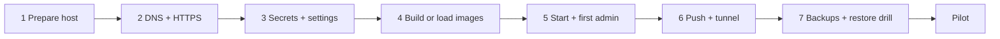

# Deploying PCMS on the college server

Ownership follows plan v1.2 section 25:
- **College IT** owns the server, DNS, certificates and firewall.
- **Facilities** owns the service.
- **Team OSSC** prepares releases.

The commands below are for a Linux server (Ubuntu 24.04 LTS or similar) with Docker Engine and the Compose plugin.



## 1. Prepare the host

- 4 CPU cores, 8 GB RAM, 256 GB SSD, wired network, UPS, plus at least 1 TB of separate backup storage.
- Create a service account (for example `pcms`) and the folders:
  ```sh
  sudo mkdir -p /srv/pcms/{secrets,certs,backups}
  sudo chown -R pcms:pcms /srv/pcms && sudo chmod 700 /srv/pcms/secrets
  ```
- Put the repository release in `/srv/pcms/app`. Allow SSH only from the management network or VPN.
  Never publish PostgreSQL or port 8000.

## 2. DNS and HTTPS

HTTPS is required either way: the camera, install, offline support and notifications do not
work over plain HTTP. There are two ways to get it, and you can use both at once.

**Certificates on the server** (campus access, the default):
- IT points an internal DNS name (for example `pcms.dbit.edu.in`) at the server.
- Get a publicly trusted certificate, for example Let's Encrypt with the DNS-01 challenge, so the
  app itself does not have to be public. Copy `fullchain.pem` and `privkey.pem` to `/srv/pcms/certs/`.
- Renewal must replace these files and then run `docker compose -f compose.prod.yml exec nginx nginx -s reload`.

**Cloudflare tunnel** (access from outside the campus, optional): Cloudflare terminates TLS at
its edge, so the server needs no certificate files and no inbound port. Skip this section and
set it up in section 6 instead. If PCMS is only ever reached off campus, the tunnel alone is
enough; `nginx` still needs certificates present to start with `pcms-tls.conf`, so either keep
a self-signed pair in `/srv/pcms/certs/` or build the image with `NGINX_CONF=pcms.conf`.

## 3. Secrets and settings

```sh
cd /srv/pcms/app
cp .env.example /srv/pcms/pcms.env && chmod 600 /srv/pcms/pcms.env
python3 -c "import secrets; print(secrets.token_urlsafe(48))"      # PCMS_SECRET_KEY
python3 -c "import secrets; print(secrets.token_urlsafe(48))"      # PCMS_CREDENTIAL_KEY
python3 -c "import secrets; print(secrets.token_urlsafe(24))" > /srv/pcms/secrets/db_password
echo "db:5432:pcms:pcms:$(cat /srv/pcms/secrets/db_password)" > /srv/pcms/secrets/pgpass
chmod 600 /srv/pcms/secrets/*
```

Edit `/srv/pcms/pcms.env`:
- Put the same database password into `PCMS_DATABASE_URL`, and set `PCMS_SECRET_KEY` and `PCMS_CREDENTIAL_KEY`.
  `PCMS_CREDENTIAL_KEY` encrypts temporary passwords until each person chooses their own. Keep it out of
  backups of the database; losing it means Team OSSC must reset any temporary password still outstanding.
- Set the hostnames, the SMTP relay, and `PCMS_MESSAGING_PROVIDER` (`none` until Twilio is ready).

**Backup encryption key.** Make it on a custodian's computer, not on the server:

```sh
age-keygen -o pcms-backup-identity.txt     # keep this private file offline, with two custodians
age-keygen -y pcms-backup-identity.txt > backup_recipient.txt
```

Copy only `backup_recipient.txt` to `/srv/pcms/secrets/`.

## 4. Build (or load) the images

On the server, with internet:

```sh
export PCMS_ENV_FILE=/srv/pcms/pcms.env
docker compose -f compose.prod.yml --env-file /srv/pcms/pcms.env build
```

For an offline server: build on another machine, `docker save` the images, copy the tar and its
`sha256sum`, then run `docker load` (plan 26.2).

## 5. Start and create the first admin

```sh
docker compose -f compose.prod.yml --env-file /srv/pcms/pcms.env up -d
docker compose -f compose.prod.yml ps                         # all healthy; migrate exited 0
docker compose -f compose.prod.yml exec api python -m app.cli create-admin --email you@dbit.edu.in --name "Full Name"
```

The command prints a temporary password. That person:
1. Opens the site and signs in with it.
2. Sets their own password.
3. Scans the authenticator QR code and saves the recovery codes.

They then create everyone else under **Admin, then People**, one at a time or with **Import file**
(Excel or CSV). The import response is a credentials workbook with the temporary passwords; share each
row with that person and delete the file afterwards. It can be downloaded again until the person sets
their own password.

`migrate` runs `check-config` first, so the stack will not start with unsafe settings.

## 6. Web push, the Cloudflare tunnel, and Twilio (legacy)

**Push**
```sh
docker compose -f compose.prod.yml exec api python -m app.cli vapid-keys
```
Put both values in `pcms.env`, set `PCMS_VAPID_SUBJECT=mailto:facilities@dbit.edu.in`, then `up -d`.
Use `python -m app.cli push-test-all` to send one test to every enabled device.

**Cloudflare tunnel**

The tunnel gives PCMS a public HTTPS hostname with **no inbound port open on the college
server**: `cloudflared` dials out to Cloudflare and traffic comes back down that connection.
It replaces step 2 (DNS and certificates) if you use it for the app, because Cloudflare
terminates TLS at its edge, so no certificate files are needed on the server.

It serves two separate hostnames, and you can publish either or both:

| Hostname | Service | Serves |
|---|---|---|
| `pcms.dbit.edu.in` | `http://nginx:8082` | The whole app and API |
| `pcms-hooks.dbit.edu.in` | `http://nginx:8081` | Twilio webhooks and signed photo links only (legacy) |

Port 8082 is an app listener that exists only for the tunnel. It is never published on the
host, so only the `cloudflared` container can reach it. It is separate from 8080 because in
production 8080 answers with a redirect to HTTPS, which would bounce the edge straight back
into the tunnel.

1. IT creates the tunnel: Cloudflare dashboard, **Zero Trust, Networks, Tunnels, Create a
   tunnel**, choose **cloudflared**, name it (for example `pcms`), save, and copy the token.
2. On the tunnel's **Public Hostname** tab add one entry per row of the table above. Service
   Type is **HTTP** (not HTTPS: this hop is inside the Docker network). The DNS record is
   created for you.
3. Put the token in `pcms.env` as `PCMS_TUNNEL_TOKEN`, set `PCMS_PUBLIC_APP_URL` to the app
   hostname and `PCMS_PUBLIC_BASE_URL` to the hooks hostname, then start the stack:
   ```sh
   docker compose -f compose.prod.yml --env-file /srv/pcms/pcms.env --profile tunnel up -d
   ```
4. Verify:
   ```sh
   docker compose -f compose.prod.yml ps tunnel          # healthy
   curl -fsS https://pcms.dbit.edu.in/api/v1/health/ready
   ```
   If it is unhealthy, `docker compose logs tunnel`: an expired or revoked token is the usual
   cause. A 403 "Just a moment" page means a Cloudflare bot-fight or challenge rule is
   intercepting the hostname; exempt it.

**Protect the app hostname with Cloudflare Access.** Publishing the app puts the sign-in page
on the open internet, and only the super admin uses a second factor
(see [SECURITY.md](SECURITY.md)). Under **Zero Trust, Access, Applications** add a
self-hosted application for `pcms.dbit.edu.in` with a policy allowing the `@dbit.edu.in`
email domain. Staff then pass the college SSO before PCMS's own login, which restores the
"campus-only" assumption the security model relies on. Do **not** put Access in front of
`pcms-hooks.dbit.edu.in`: Twilio cannot sign in, and that listener already verifies request
signatures and serves nothing else.

The firewall on the host stays closed; the tunnel needs outbound 443 only:

```sh
sudo ufw default deny incoming
sudo ufw allow OpenSSH
sudo ufw enable
```

**Twilio (legacy)**
Worker dispatch is retired. PCMS no longer queues new worker messages, so a new installation
does not need Twilio at all. Keep the existing Twilio settings, templates and webhook only until
the messages that were sent before the cutover have drained. Their status updates and Accept
taps still work through the handlers described in `docs/SECURITY.md`.

To keep the old messages working on an existing installation:
1. Keep the WhatsApp sender, the SMS number or Messaging Service, the `HX...` template SIDs, the
   account SID, the auth token and the senders in `pcms.env`.
2. Keep the WhatsApp sender's incoming-message webhook at
   `https://pcms-hooks.dbit.edu.in/webhooks/twilio`.
3. Keep `PCMS_MESSAGING_PROVIDER=twilio` until those messages are delivered or expired.

For a fresh installation, set `PCMS_MESSAGING_PROVIDER=none`. Managers contact workers directly
and record the state on the ticket; nothing else changes.

A later cleanup release can remove Twilio, the provider settings and the `worker`, `worker_skill`
and `assignment` tables after a backup.

## 7. Backups and the restore drill

The `backup` service runs nightly at `PCMS_BACKUP_AT` (Asia/Kolkata):
- It dumps the database, copies media and a manifest, and encrypts everything to `/srv/pcms/backups`.
- It keeps 7 daily and 4 weekly backups.
- `LAST_SUCCESS` records the time of the last good backup. Alert if it is older than 26 hours.
- Off-host copy: set `BACKUP_COPY_CMD` (for example an `rsync` to the backup store), or have IT pull the folder.
  A backup on the same server does not protect against losing the server.

**Restore**
```sh
docker compose -f compose.prod.yml stop api worker scheduler
docker compose -f compose.prod.yml run --rm -v /path/to/pcms-backup-identity.txt:/run/identity.txt:ro \
  backup restore.sh /backups/pcms-YYYYmmdd-HHMM-Day.tar.age /run/identity.txt
# add --profile tunnel if this installation publishes PCMS through the tunnel
docker compose -f compose.prod.yml up -d
```

What the restore does:
- Verifies the checksums.
- Restores the database and media together.
- Cancels unsent notifications, so old messages are not replayed.
- Signs everyone out.
- Checks the ticket count against the manifest.

Do a drill monthly on a separate machine (plan 28). The same scripts were drilled on 18 October 2026:
the dev database and media were restored into a scratch database and volume, and the counts matched.

## Updating

1. Announce a window and check `LAST_SUCCESS` is recent.
2. Run a manual backup: `docker compose -f compose.prod.yml exec backup backup.sh`.
3. Deploy: `git pull` (or load the new images), then `docker compose -f compose.prod.yml --env-file /srv/pcms/pcms.env up -d --build`.
   `migrate` applies migrations before `api` starts.
   **Repeat every profile this installation uses, such as `--profile tunnel`, on each `up -d`.**
   A missing profile is not an error: the service is simply not started. Leave it off and the
   tunnel quietly goes down, so PCMS stops answering off campus until the next deploy.
4. Smoke test: sign in, open the queue, raise a test ticket. If the tunnel is in use, do the
   sign-in through the public hostname so the test covers that path too.

Open browsers show "A new version is ready", so nobody loses a half-filled form.

**Rollback.** Start the previous images. If a migration already ran and is not backward compatible,
restore the backup from step 2. Reverting a container does not undo a migration.
