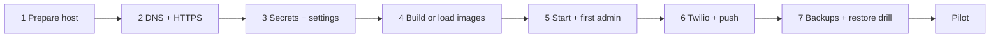

# Deploying PCMS on the college server

Ownership follows plan v1.2 section 25:
- **College IT** owns the server, DNS, certificates and firewall.
- **Facilities** owns the service.
- **Team OSSC** prepares releases.

The commands below are for a Linux server (Ubuntu 24.04 LTS or similar) with Docker Engine and the Compose plugin.



## 1. Prepare the host

- 4 CPU cores, 8 GB RAM, 256 GB SSD, wired network, UPS, plus at least 1 TB of separate backup storage.
- Create a service account (for example `pcms`) and the folders:
  ```sh
  sudo mkdir -p /srv/pcms/{secrets,certs,backups}
  sudo chown -R pcms:pcms /srv/pcms && sudo chmod 700 /srv/pcms/secrets
  ```
- Put the repository release in `/srv/pcms/app`. Allow SSH only from the management network or VPN.
  Never publish PostgreSQL or port 8000.

## 2. DNS and HTTPS

- IT points an internal DNS name (for example `pcms.dbit.edu.in`) at the server.
- Get a publicly trusted certificate, for example Let's Encrypt with the DNS-01 challenge, so the
  app itself does not have to be public. Copy `fullchain.pem` and `privkey.pem` to `/srv/pcms/certs/`.
- Renewal must replace these files and then run `docker compose -f compose.prod.yml exec nginx nginx -s reload`.
- HTTPS is required: the camera, install, offline support and notifications do not work over plain HTTP.

## 3. Secrets and settings

```sh
cd /srv/pcms/app
cp .env.example /srv/pcms/pcms.env && chmod 600 /srv/pcms/pcms.env
python3 -c "import secrets; print(secrets.token_urlsafe(48))"      # PCMS_SECRET_KEY
python3 -c "import secrets; print(secrets.token_urlsafe(24))" > /srv/pcms/secrets/db_password
echo "db:5432:pcms:pcms:$(cat /srv/pcms/secrets/db_password)" > /srv/pcms/secrets/pgpass
chmod 600 /srv/pcms/secrets/*
```

Edit `/srv/pcms/pcms.env`:
- Put the same database password into `PCMS_DATABASE_URL`, and set `PCMS_SECRET_KEY`.
- Set the hostnames, the SMTP relay, and `PCMS_MESSAGING_PROVIDER` (`none` until Twilio is ready).

**Backup encryption key.** Make it on a custodian's computer, not on the server:

```sh
age-keygen -o pcms-backup-identity.txt     # keep this private file offline, with two custodians
age-keygen -y pcms-backup-identity.txt > backup_recipient.txt
```

Copy only `backup_recipient.txt` to `/srv/pcms/secrets/`.

## 4. Build (or load) the images

On the server, with internet:

```sh
export PCMS_ENV_FILE=/srv/pcms/pcms.env
docker compose -f compose.prod.yml --env-file /srv/pcms/pcms.env build
```

For an offline server: build on another machine, `docker save` the images, copy the tar and its
`sha256sum`, then run `docker load` (plan 26.2).

## 5. Start and create the first admin

```sh
docker compose -f compose.prod.yml --env-file /srv/pcms/pcms.env up -d
docker compose -f compose.prod.yml ps                         # all healthy; migrate exited 0
docker compose -f compose.prod.yml exec api python -m app.cli create-admin --employee-id OSSC001 --name "Full Name" --email you@dbit.edu.in
```

The command prints a temporary password. That person:
1. Opens the site and signs in with it.
2. Sets their own password.
3. Scans the authenticator QR code and saves the recovery codes.

They then import everyone else under **Admin, then People, then Import CSV**.

`migrate` runs `check-config` first, so the stack will not start with unsafe settings.

## 6. Twilio (legacy) and web push

**Push**
```sh
docker compose -f compose.prod.yml exec api python -m app.cli vapid-keys
```
Put both values in `pcms.env`, set `PCMS_VAPID_SUBJECT=mailto:facilities@dbit.edu.in`, then `up -d`.
Use `python -m app.cli push-test-all` to send one test to every enabled device.

**Tunnel** (only Twilio's webhooks and photo links are public)
1. IT creates a Cloudflare named tunnel with a public hostname (for example `pcms-hooks.dbit.edu.in`)
   whose service is `http://nginx:8081`.
2. Set `PCMS_TUNNEL_TOKEN` and `PCMS_PUBLIC_BASE_URL=https://pcms-hooks.dbit.edu.in`.
3. Start with `--profile tunnel`.

**Twilio (legacy)**
Worker dispatch is retired. PCMS no longer queues new worker messages, so a new installation
does not need Twilio at all. Keep the existing Twilio settings, templates and webhook only until
the messages that were sent before the cutover have drained. Their status updates and Accept
taps still work through the handlers described in `docs/SECURITY.md`.

To keep the old messages working on an existing installation:
1. Keep the WhatsApp sender, the SMS number or Messaging Service, the `HX...` template SIDs, the
   account SID, the auth token and the senders in `pcms.env`.
2. Keep the WhatsApp sender's incoming-message webhook at
   `https://pcms-hooks.dbit.edu.in/webhooks/twilio`.
3. Keep `PCMS_MESSAGING_PROVIDER=twilio` until those messages are delivered or expired.

For a fresh installation, set `PCMS_MESSAGING_PROVIDER=none`. Managers contact workers directly
and record the state on the ticket; nothing else changes.

A later cleanup release can remove Twilio, the provider settings and the `worker`, `worker_skill`
and `assignment` tables after a backup.

## 7. Backups and the restore drill

The `backup` service runs nightly at `PCMS_BACKUP_AT` (Asia/Kolkata):
- It dumps the database, copies media and a manifest, and encrypts everything to `/srv/pcms/backups`.
- It keeps 7 daily and 4 weekly backups.
- `LAST_SUCCESS` records the time of the last good backup. Alert if it is older than 26 hours.
- Off-host copy: set `BACKUP_COPY_CMD` (for example an `rsync` to the backup store), or have IT pull the folder.
  A backup on the same server does not protect against losing the server.

**Restore**
```sh
docker compose -f compose.prod.yml stop api worker scheduler
docker compose -f compose.prod.yml run --rm -v /path/to/pcms-backup-identity.txt:/run/identity.txt:ro \
  backup restore.sh /backups/pcms-YYYYmmdd-HHMM-Day.tar.age /run/identity.txt
docker compose -f compose.prod.yml up -d
```

What the restore does:
- Verifies the checksums.
- Restores the database and media together.
- Cancels unsent notifications, so old messages are not replayed.
- Signs everyone out.
- Checks the ticket count against the manifest.

Do a drill monthly on a separate machine (plan 28). The same scripts were drilled on 18 October 2026:
the dev database and media were restored into a scratch database and volume, and the counts matched.

## Updating

1. Announce a window and check `LAST_SUCCESS` is recent.
2. Run a manual backup: `docker compose -f compose.prod.yml exec backup backup.sh`.
3. Deploy: `git pull` (or load the new images), then `docker compose -f compose.prod.yml --env-file /srv/pcms/pcms.env up -d --build`.
   `migrate` applies migrations before `api` starts.
4. Smoke test: sign in, open the queue, raise a test ticket.

Open browsers show "A new version is ready", so nobody loses a half-filled form.

**Rollback.** Start the previous images. If a migration already ran and is not backward compatible,
restore the backup from step 2. Reverting a container does not undo a migration.
