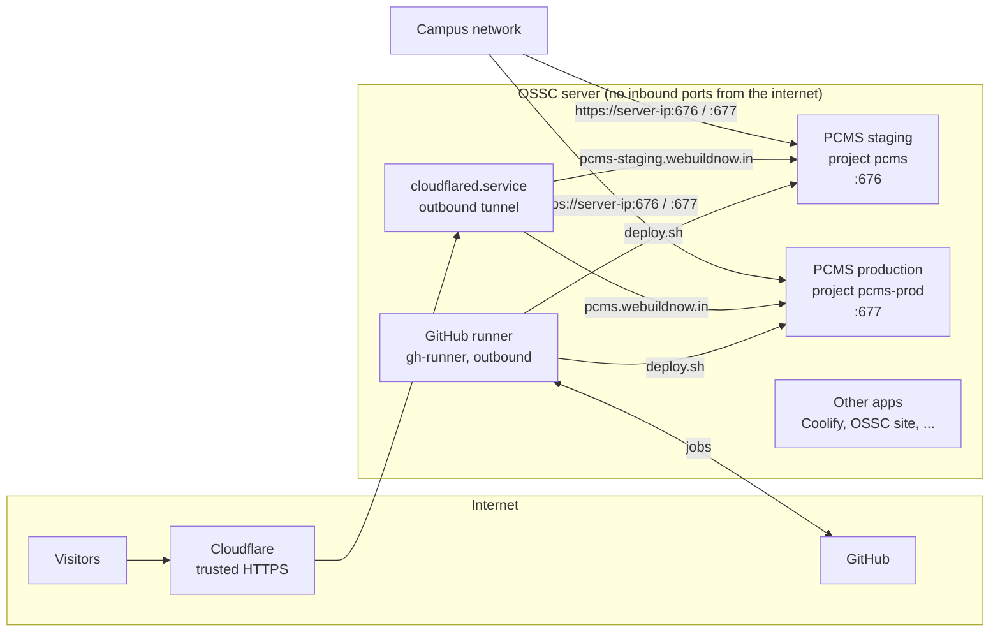

# The OSSC server: how apps are hosted

Runbook for the OSSC server (Dell Precision 7820, Ubuntu 24.04, `dbit-oscc-Precision-7820-Tower`) that runs
PCMS staging and production, and the rules for adding more apps to it. PCMS-specific history is in
[pcms-deployment-2026-11-02.md](pcms-deployment-2026-11-02.md); how the deploy works is in
[DEPLOYMENT.md](DEPLOYMENT.md) section 8.

## The picture



- **Visitors** reach apps only through the Cloudflare tunnel (`cloudflared.service`). The tunnel connects
  out to Cloudflare, so no port is open to the internet. Cloudflare serves the trusted certificate.
- **On campus**, apps are also reachable directly at `https://<server-ip>:<port>`, with each app's own
  self-signed certificate. That gives a certificate warning, and browsers then refuse push notifications and
  app install, so use the domain for those.
- **Deploys** come from GitHub Actions through a self-hosted runner on this server. The runner also connects
  out, so GitHub never logs in to the server and holds no server secret.

## What runs here

| Port | What | Reached by |
|---|---|---|
| 22 | SSH | campus / VPN only |
| 676 / 8082 | PCMS **staging** nginx (HTTPS / redirect) | `pcms-staging.webuildnow.in`, campus |
| 677 / 8083 | PCMS **production** nginx (HTTPS / redirect) | `pcms.webuildnow.in`, campus |
| 8000, 6001, 6002 | Coolify (`coolify.webuildnow.in`) | tunnel |
| 8080 | OSSC website (`OSSC.webuildnow.in`) | tunnel |
| 9000, 9443 | Portainer | campus |
| 9090 | Cockpit | campus |
| 20128 | OmniRoute | |

**Add a row here before you take a port.** `sudo ss -ltnp` shows what is listening.

## Folder layout

| Path | What | Owner, mode |
|---|---|---|
| `/srv/server-data/staging/pcms/` | PCMS staging's `pcms.env` (root:pcms 640) and its `certs`, `secrets`, `backups` | root; `backups` uid 70 |
| `/srv/server-data/production/pcms/` | PCMS production's `pcms.env` (root:pcms 640) and its `certs`, `secrets`, `backups` | root; `backups` uid 70 |
| `/srv/server-data/staging/<app>/`, `/srv/server-data/production/<app>/` | the same for every other app, side by side | per app |
| `/srv/server-data/pcms/`, `/srv/pcms/` | **old** PCMS staging layout (checkout and files), kept only until the first CD deploy works; then remove them (below) | root |
| `/etc/pcms/staging.conf`, `production.conf` | where each environment is (no secrets) | root, 644 |
| `/srv/actions-runner/` | the GitHub runner; `_work/pcms/pcms` is the checkout of the last deploy | gh-runner |
| `/var/lib/pcms-deploy/` | what is deployed now, the previous release, history | gh-runner |
| `/usr/local/bin/pcms` | the day-to-day helper command | root |

## Day-to-day commands (PCMS)

```sh
sudo pcms staging status                 # release, containers, health check, last deploys
sudo pcms production status
sudo pcms staging logs api               # or worker, nginx, migrate, backup; add -f to follow
sudo pcms production admin --email you@dbit.in --name "Your Name"   # create a Team OSSC admin
sudo pcms staging backup                 # back up now
sudo pcms staging psql                   # open the database
sudo pcms staging rollback               # go back to the previous release
sudo pcms staging compose ps             # any docker compose command for that environment
```

Deploying is done by pushing to GitHub (`dev` to staging, `main` to production), never by hand. To redeploy
the same commit: GitHub, Actions, Deploy, Run workflow.

**Never run `docker compose up` (or `--build`) yourself on this server.** Without `-p`, compose names the
project after the current folder, so a run from a folder called `pcms` replaces **staging's** containers with
whatever code is in that folder; if that code is older than the database, the migration fails and staging goes
down (5 November, see the deployment log, problem 8). Production is never started this way either: it is
project `pcms-prod` and starts when `dev` is merged into `main`. If staging or production is down, re-run the
last good deploy from Actions, or `sudo pcms <env> rollback`.

## Setting up a PCMS environment (already done for staging; once for production)

One command per environment, from any checkout of the repository on the server. It is safe to run again and
never replaces a secret that is already set:

```sh
curl -fsSL https://raw.githubusercontent.com/OSSC-DBIT/pcms/dev/ops/deploy/setup-environment.sh -o /tmp/setup-env.sh
sudo bash /tmp/setup-env.sh staging    --email <ossc contact email>
sudo bash /tmp/setup-env.sh production --email <ossc contact email>
```

What it does (`ops/deploy/setup-environment.sh`):
- folders with the right owners (the backup folder for uid 70, the backup container);
- the settings file: for **production** a new one with a fresh database password and keys; for **staging**
  the existing one cleaned (removes settings that no longer exist, keeps a dated `.bak` copy) and completed;
- web push keys, the push contact, and the campus address (`PCMS_ALLOWED_ORIGINS` / `PCMS_ALLOWED_HOSTS`);
- the backup key pair: the public half in `secrets/`, the **private half in `/root/pcms-<env>-backup-identity.txt`**
  (copy it to two custodians, then delete it from the server; it is the only way to read the backups);
- a self-signed certificate naming the domain and the server IP;
- `/etc/pcms/<env>.conf` and the `pcms` helper.

Then, in **Cloudflare Zero Trust, Networks, Tunnels**, the tunnel, **Public hostname, Add**:

| Subdomain | Domain | Type | URL | Additional settings |
|---|---|---|---|---|
| `pcms-staging` | `webuildnow.in` | HTTPS | `localhost:676` | TLS: **No TLS Verify** on |
| `pcms` | `webuildnow.in` | HTTPS | `localhost:677` | TLS: **No TLS Verify** on |

**No TLS Verify** is needed because nginx's certificate is self-signed. It covers only the hop from
`cloudflared` to nginx on this machine; visitors get Cloudflare's trusted certificate.

### Retiring the old staging layout

There is no clone of the repository to maintain: the runner checks out the right commit for every deploy
(`/srv/actions-runner/_work/pcms/pcms`), for staging and production alike. The old checkout
`/srv/server-data/pcms` and `/srv/pcms` were staging's home before continuous deployment; the setup script
copied what staging needs into `/srv/server-data/staging/pcms`. **After** the first staging deploy reports `deployed ... and
healthy` and `sudo pcms staging status` shows the new release, keep a copy and remove them:

```sh
sudo tar -C /srv -czf /root/pcms-old-staging-$(date +%F).tar.gz server-data/pcms pcms
sudo docker compose -p pcms-dev down 2>/dev/null || true      # the old dev stack, if it still runs (no -v)
sudo rm -rf /srv/server-data/pcms /srv/pcms
```

`/srv/server-data/pcms` (the old checkout) and `/srv/server-data/staging/pcms` (staging's settings now) are
different folders: remove only the first.

The archive holds the old `.env` with the one-time admin passwords: delete it once you are sure nothing is
missing. The database and uploads are not in these folders (they are the Docker volumes `pcms_pgdata` and
`pcms_media`), so this does not touch staging's data.

## The GitHub runner

- Service `actions.runner.OSSC-DBIT-pcms.ossc-server`, user `gh-runner`, label `pcms`, registered to the
  `OSSC-DBIT/pcms` repository. Check it: `systemctl status 'actions.runner.*'`, or GitHub, Settings, Actions,
  Runners (it should say **Idle**).
- `gh-runner` is in the `docker` group, which is root on this machine, and in the `pcms` group, so it can read
  the PCMS settings files. Use the account for nothing else.
- Restart: `cd /srv/actions-runner && sudo ./svc.sh stop && sudo ./svc.sh start`.
- Update: the runner updates itself.
- Remove: `sudo ./svc.sh uninstall`, then `sudo -u gh-runner ./config.sh remove --token <token from GitHub>`.

**The repository is public, so the runner must only ever run trusted code.**
- Deploys run only from `deploy.yml`, on a push to `dev` or `main`. Both branches are protected: changes need
  a pull request with passing CI, and no force pushes.
- Workflows from outside contributors wait for a maintainer's approval (repository setting). **Never approve a
  run from a fork that changes anything under `.github/`**: it could run on this server.
- The default workflow token is read-only.

## Adding another app to this server

Follow the same pattern so every app stays separate and deploys the same way:

1. **Ports:** pick free ones and add them to the table above. Publish only the app's web port; never a database.
2. **Compose project name:** unique per app and environment (for example `myapp`, `myapp-prod`), so containers,
   networks and volumes never collide. Never use `docker compose down -v` on someone else's project.
3. **Folders:** `/srv/server-data/staging/<app>/` and `/srv/server-data/production/<app>/` for its settings file, certificates and backups.
   Settings file mode 640, owner root, group of the app.
4. **Domain:** add a Cloudflare public hostname pointing at `localhost:<port>`. If the app serves HTTPS with a
   self-signed certificate, turn on No TLS Verify.
5. **Deploys:** for a repository in the `OSSC-DBIT` organisation, either
   - register **one runner per repository** with that repository's label, as for PCMS (simplest, and keeps each
     repository's code apart), or
   - have an organisation admin create an organisation runner in a **runner group limited to the chosen
     repositories**, so one runner serves several apps. Only do this for repositories whose `main` and `dev` are
     protected, since any workflow those repositories run there has root on this machine.
   Copy `ops/deploy/deploy.sh` and `.github/workflows/deploy.yml` from PCMS as a starting point: tagged images
   per environment and commit, a backup first, migrations while the old release keeps serving, a health check.
6. **Backups:** every app with data gets its own nightly encrypted backup and its own key.
7. **Write it down:** a section in this file (what, ports, folders, domain, how to deploy, how to restore).

## Known issues on this machine

- **Package manager blocked by an unfinished kernel update** (5 November 2026). The NVIDIA module for kernel
  `7.0.0-42` fails to build because that kernel's headers are incomplete, so `apt` stops with `dpkg returned an
  error code (1)`. PCMS and the runner do not need `apt`. The usual fix is
  `sudo apt-get install --reinstall linux-headers-7.0.0-42-generic` then `sudo dpkg --configure -a`. Agree it
  with whoever looks after the machine, and do not reboot into `7.0.0-42` until `dpkg` finishes cleanly.
- **Rate limits:** all tunnel traffic reaches nginx from one address, so every visitor shares one sign-in rate
  limit. nginx should read Cloudflare's `CF-Connecting-IP`; this is a code change still to do.
- **Firewall:** check `sudo ufw status` allows campus machines to 676 and 677 and nothing extra.
